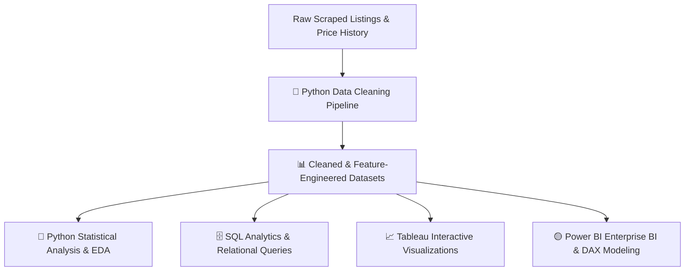

# 🚗 Egyptian Used Cars Market Intelligence & Statistical Analysis

[](python/)
[](sql/)
[](tableau/)
[](power_bi/)
[](LICENSE)

An end-to-end multi-tool data analytics and econometrics project exploring the **Egyptian Used Car Market**. This study analyzes market supply, historical price fluctuations, depreciation dynamics, vehicle condition scoring, and value-retention patterns using **Python**, **SQL**, **Tableau**, and **Power BI**.

---

## 📌 Executive Summary & Context

The Egyptian automotive market has undergone massive macroeconomic transformations, characterized by currency exchange shifts, import restrictions, and heightened inflation. In this environment, used cars serve not only as transportation assets but also as hedge instruments and stores of value.

### Key Questions Addressed:
1. **Price Dispersion & Volatility**: How do monthly prices fluctuate across different brand tiers and vehicle segments?
2. **Depreciation Dynamics**: What is the actual annual depreciation curve for cars in Egypt when controlling for mileage, age, condition, and horsepower?
3. **Market Segmentation**: Which brands and models demonstrate superior price retention versus aggressive depreciation?
4. **Anomaly & Fraud Detection**: How can we detect odometer rollbacks (`mileage_suspect`) and misclassified vehicle specs?

---

## 🛠️ Multi-Tool Analytics Architecture

This project is intentionally designed as a multi-tool case study, leveraging the strengths of each technology:



### 1. 🐍 Python
- **Data Cleaning & Wrangling**: Automated cleaning pipeline handling missing values, standardizing trim/model naming, IQR outlier trimming, and feature engineering (e.g., `car_age`, `km_per_year`, `Brand_Tier`, `Condition_Score`).
  > *Note: The data cleaning stage was implemented using Python and will be committed into the repository.*
- **Exploratory Data Analysis (EDA)**: Distribution profiling, skewness correction, and multi-variable correlations.
- **Statistical Modeling**:
  - **Hypothesis Testing**: One-Way ANOVA / Kruskal-Wallis across brand tiers; two-sample tests on transmission and fuel types.
  - **Econometric OLS Regression**: Log-linear regression modeling price depreciation ($\log(\text{Price}) \sim \text{Age} + \text{Mileage} + \text{HP} + \text{Condition}$).
  - **Multicollinearity & Residual Diagnostics**: VIF evaluation and Q-Q normality validation.

### 2. 🗄️ SQL (Relational Analysis)
- **Relational Schema**: Structured DDL for vehicle listings and monthly price history.
- **Advanced Querying**:
  - CTEs and Window Functions (`LAG`, `LEAD`, `RANK()`, `AVG() OVER()`) to measure month-over-month price evolution and annual model depreciation.
  - Anomaly auditing queries to flag suspicious mileage-to-age ratios.
  - Price benchmark comparisons identifying undervalued listings for deal discovery.

### 3. 📊 Tableau
- **Interactive Visual Storytelling**:
  - Visual exploration of price elasticity vs. mileage across brands.
  - Dual-axis historical price fluctuation envelope charts.
  - Parameterized deal-finder dashboards for consumer decision support.

### 4. 🟡 Power BI
- **Enterprise Star Schema**: Fact-Dimension data model linking listings and monthly price history with shared dimensions (Date, Brand, Specifications).
- **DAX Calculations**: Comprehensive metric library including Average Price, Median Price, Price Spread, YoY Change, and Benchmark Discount %.
- **Executive Reporting**: Interactive KPI dashboards tailored for automotive dealerships, investors, and consumers.

---

## 📁 Repository Structure

```plaintext
Egyptian-Used-Cars/
│
├── .gitignore                          # Standard git ignore for Python, BI & temp files
├── README.md                           # Main repository overview (this document)
│
├── data/                               # Dataset repository
│   ├── README.md                       # Comprehensive data dictionary & schema
│   ├── raw/                            # Original raw scraped files
│   │   ├── used_cars.csv
│   │   └── price_history.csv
│   └── cleaned/                        # Refined, feature-engineered datasets
│       ├── used_cars_cleaned.csv
│       └── price history_super cleaned.csv
│
├── python/                             # Python workflows
│   ├── README.md                       # Python analysis & statistical methodology
│   ├── requirements.txt                # Python environment dependencies
│   ├── notebooks/                      # Jupyter Notebooks (Cleaning, EDA, Stats)
│   └── scripts/                        # Utility functions & data helpers
│
├── sql/                                # SQL scripts & queries
│   ├── README.md                       # SQL analytics guide
│   ├── schema_setup.sql                # Table DDL & indexing scripts
│   └── analysis_queries.sql            # Analytical queries (CTEs, Window Functions)
│
├── tableau/                            # Tableau workbooks & dashboards
│   └── README.md                       # Visual design plan & calculated fields
│
├── power_bi/                           # Power BI models & reports
│   └── README.md                       # Star schema documentation & DAX measures
│
└── docs/                               # Additional reports and statistical findings
```

---

## 📊 Dataset Overview

The project is driven by two core datasets:

| Dataset | Records / Scope | Key Highlights |
| :--- | :--- | :--- |
| **`used_cars_cleaned.csv`** | Cleaned individual listings | Brand, Model, Trim, Year, Price (EGP), Mileage (km), Condition Score, Brand Tier, Odometer anomaly flags. |
| **`price history_super cleaned.csv`** | Time-series monthly aggregates | Brand, Model, Year, Snapshot Date, Average Price, Min/Max Price, Volatility Range %. |

For complete column definitions and data types, refer to the [Data Documentation](data/README.md).

---

## 🔬 Statistical Analysis Highlights

The statistical evaluation examines key economic and market hypotheses:

1. **Market Segmentation Hypothesis**:
   - $H_0$: There is no significant difference in depreciation rates across Brand Tiers (Economy vs. Mid-Range vs. Luxury).
   - $H_1$: Luxury vehicles exhibit a significantly higher initial depreciation velocity compared to economy vehicles in Egypt.
2. **Odometer vs. Age Elasticity**:
   - Quantifying the marginal price penalty of $+10,000\text{ km}$ versus $+1\text{ year}$ of vehicle age.
3. **Normality & Transformations**:
   - Application of Log-transformations on vehicle price to stabilize variance and meet OLS linear regression assumptions.

---

## 🚀 Getting Started

### 1. Clone the Repository
```bash
git clone https://github.com/<YOUR_USERNAME>/<YOUR_REPO_NAME>.git
cd <YOUR_REPO_NAME>
```

### 2. Set Up the Python Environment
```bash
# Create a virtual environment
python -m venv .venv

# Activate the virtual environment
# Windows (PowerShell):
.venv\Scripts\Activate.ps1
# Mac/Linux:
source .venv/bin/activate

# Install dependencies
pip install -r python/requirements.txt
```

### 3. Run SQL Queries
Load the CSV files into PostgreSQL, SQLite, or DuckDB using `sql/schema_setup.sql`, and execute `sql/analysis_queries.sql`.

### 4. Open BI Tools
- **Tableau**: Connect to `data/cleaned/used_cars_cleaned.csv`.
- **Power BI**: Open Power BI Desktop, import the data model, and review the DAX measures defined in `power_bi/README.md`.

---

## 🗺️ Project Roadmap & Next Steps

- [x] Repository architecture & directory organization.
- [x] Initial raw and cleaned dataset staging with complete data dictionary.
- [x] SQL DDL schema definitions and analytical queries.
- [x] Power BI Star Schema and DAX measure specifications.
- [x] Tableau dashboard architecture and calculated field definitions.
- [ ] Add the Python Data Cleaning script/notebook (`01_data_cleaning.ipynb`).
- [ ] Execute exploratory data analysis and publish distribution plots.
- [ ] Run econometric regression models and ANOVA statistical tests.
- [ ] Build and publish the Power BI `.pbix` report.
- [ ] Build and publish the interactive Tableau Public story.

---

## 👤 Author & Acknowledgments

- **Author**: Data Analytics Specialist
- **Domain**: Egyptian Automotive Market & Valuation Intelligence
- **Contributions**: Pull requests, issues, and suggestions are welcome!
