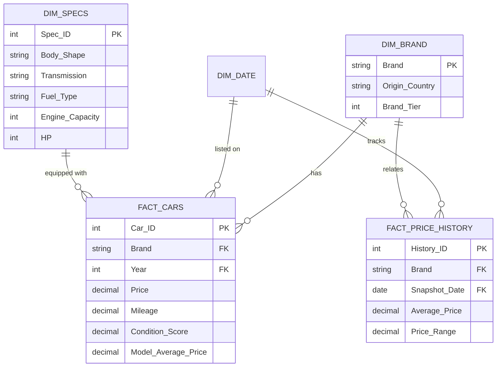

# 🟡 Power BI Business Intelligence & Modeling

This module houses the enterprise Power BI data modeling, Star Schema architecture, and DAX metric suite for the Egyptian Used Cars market.

---

## 🏗️ Data Model Architecture (Star Schema)



---

## 📐 Key DAX Measures

### 1. Market Inventory Metrics
```dax
Total Listings = COUNTROWS(used_cars_cleaned)

Zero KM Listings = 
CALCULATE(
    [Total Listings], 
    used_cars_cleaned[is_zero_km] = TRUE()
)

Pct Zero KM = 
DIVIDE([Zero KM Listings], [Total Listings], 0)
```

### 2. Pricing & Valuation Measures
```dax
Average Market Price = AVERAGE(used_cars_cleaned[Price])

Median Market Price = MEDIAN(used_cars_cleaned[Price])

Price Spread (IQR Proxy) = 
PERCENTILE.INC(used_cars_cleaned[Price], 0.75) - PERCENTILE.INC(used_cars_cleaned[Price], 0.25)
```

### 3. Depreciation & Value Intelligence
```dax
Average Price per Year of Age = 
DIVIDE(
    [Average Market Price], 
    AVERAGE(used_cars_cleaned[car_age]), 
    0
)

Discount vs Model Benchmark % = 
AVERAGEX(
    used_cars_cleaned,
    DIVIDE(
        used_cars_cleaned[model_average_price] - used_cars_cleaned[Price],
        used_cars_cleaned[model_average_price],
        0
    )
)
```

---

## 📊 Report Pages Plan
1. **Executive Overview**: Market size, volume by brand tier, average pricing indicators.
2. **Depreciation & Mileage Analytics**: Decomposition tree and scatter analysis for price erosion vs age & odometer.
3. **Historical Pricing & Inflation Monitor**: Time-series matrix tracking historical price shifts and inflation effects in EGP.
4. **Deal Finder Tool**: Parameterized filter tool to identify undervalued vehicle listings based on condition score and benchmark discount.
